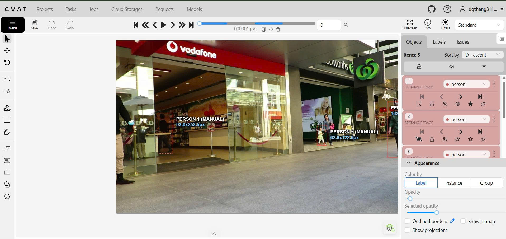
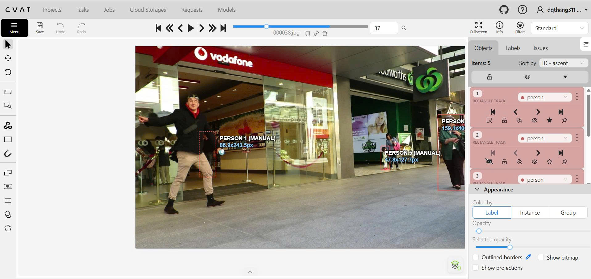
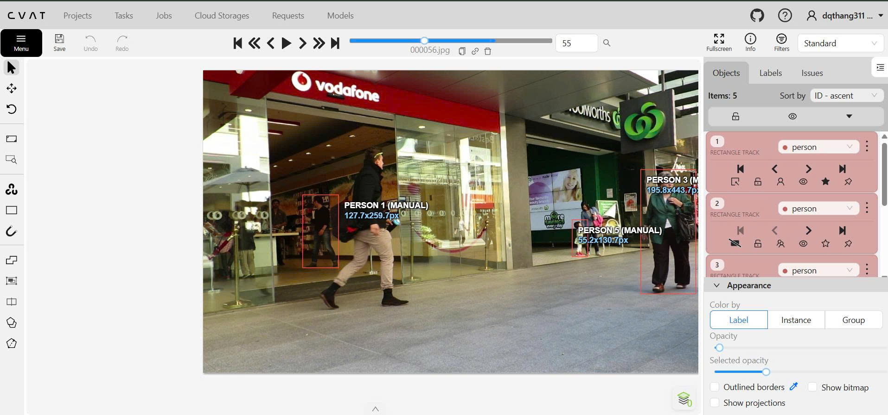

# Báo cáo cá nhân — ĐINH QUANG THẮNG (2A202603152)

Đoạn video: MOT17-09, 150 frame (frame CVAT 0–149), nguồn MOTChallenge, giấy phép CC BY-NC-SA 3.0.

## 0. Thông tin học viên

- Họ tên: ĐINH QUANG THẮNG
- MSSV: 2A202603152
- Mã đề (A/B/C): A
- Email: 26ai.thangdq4@vinuni.edu.vn
- Link repository: https://github.com/quangthang311/K5-L2-DAY05-DinhQuangThang-2A202603152-MOTTracking
- Giờ bắt đầu: 
- Giờ kết thúc: 

## 1. Xem trước đoạn video (CP0)

| Mã | Frame xuất hiện | Frame cuối thấy được | Rẽ / dừng / đổi tốc độ ở frame | Bị che ở frame | Ghi chú |
|---|---:|---:|---|---|---|
| P1 | 0 | 149 |  | 0–16, 26–38; outside 39–52; hiện lại 53, rõ trở lại 55 | Có khoảng vắng 39–52 |
| P2 | 61 | 149 |  | 61–83, 91–92, 95–96, 101 | Có cờ `occluded`|
| P3 | 0 | 149 |  | Không có `occluded`|  |
| P4 | 40 | 149 |  | Không có `occluded` |  |
| P5 | 0 | 146 |  | 106–108, 136–138, 144–146; outside 109–135 và từ 147 | Có hai lần `outside` |

## 2. Keyframe và thời gian (CP1, CP4)

Số keyframe lấy từ kết quả src/check_submission.py.

| Mã | Số keyframe | Keyframe ở frame | Số frame có mặt | Keyframe / 100 frame | Thời gian (phút) | Chỗ khó |
|---|---:|---|---:|---:|---|---|
| P1 | 126 | 0–19, 21–22, 24–26, 28–38, 53–58, 60–75, 77–104, 106–109, 111–133, 135–143, 145–146, 148–149 | 136 | 92.6 |  | Có đoạn che/outside 39–52 |
| P2 | 76 | 61–62, 64–105, 107–110, 112–113, 115–117, 120–123, 125–133, 135, 137–141, 143–145, 149 | 89 | 85.4 |  | Nhiều đoạn bật/tắt `occluded` |
| P3 | 143 | 0–42, 44–50, 52, 54, 56–71, 73–98, 100–110, 112–149 | 150 | 95.3 |  | Mật độ keyframe cao |
| P4 | 86 | 40, 43, 47, 50, 53, 55, 57, 59, 61–67, 69–85, 88, 91–105, 107–122, 124–125, 127–130, 133–143, 145–149 | 110 | 78.2 |  |  |
| P5 | 29 | 0, 2–10, 13–14, 16–18, 24, 26, 30, 33, 38, 44, 104, 106, 136–137, 139, 141, 144, 146 | 120 | 24.2 |  | Bị khuất và outside 109–135 |
| **Tổng** | **460** | — | **605** | **76.0** |  |  |

Keyframe / 100 frame của cả bài = 460 ÷ 605 × 100 = **76.0**.

P3 có nhiều keyframe nhất (143); keyframe của P3 được đặt gần như mỗi frame. Lý do P3 xuất hiện từ đầu tới cuối frame.

## 3. Đoạn bị che (CP2)

Người bị che: `P1` (track 0 trong file CVAT).

| Mốc | Frame |
|---|---:|
| Bắt đầu bị che một phần (bật `occluded`) | 26 |
| Mất hẳn (bật `outside`) | 39 |
| Hiện lại (tắt `outside`) | 53 |
| Thấy rõ trở lại (tắt `occluded`) | 55 |

- Thời gian khuất hẳn: **14 frame = khoảng 0.47 giây** (14 frame vắng, video 30 fps).
- Quyết định: **giữ cùng ID P1**.
- Lý do: khoảng vắng 14 frame ngắn hơn ngưỡng 60 frame; annotation tiếp tục cùng track sau khi hiện lại; các ảnh trước/giữa/sau cho thấy vị trí tiếp nối theo hướng di chuyển.

Ảnh chụp màn hình:





## 4. Tự review ID (CP3)

Lượt 1 theo người (đi ngược từ frame 149 về 0 trên CVAT), lượt 2 theo cảnh (nhảy 10 frame). Ít nhất 3 dòng; không có lỗi thì ghi một dòng "đã kiểm hai lượt, không lỗi".

Loại lỗi dùng đúng một trong 7 mã: `id_switch`, `fragmentation`, `lost, merge`, `false_track`, `drift`, `flag`.

| Frame | Mã người | Loại lỗi | Mô tả một câu | Phát hiện ở lượt | Đã sửa? |
|---:|---|---|---|---|---|
|  |  |  |  |  |  |
|  |  |  |  |  |  |
|  |  |  |  |  |  |

Tổng hợp số lỗi theo loại (chưa thể xác định nếu chưa có kết quả review):

| `id_switch` | `fragmentation` | `lost` | `merge` | `false_track` | `drift` | `flag` |
|---:|---:|---:|---:|---:|---:|---:|
|  |  |  |  |  |  |  |

Lỗi nào chỉ lượt 2 (theo cảnh) mới thấy, lượt 1 (theo người) không thấy?

## 5. File xuất và kết quả tự kiểm (CP4)

| Kiểm tra | Kết quả |
|---|---|
| Tên file MOT 1.1 | `src/exports/DinhQuangThang_mot.zip` |
| Tên file CVAT for video 1.1 | `src/exports/DinhQuangThang_cvat_video.zip` |
| Số track ID khác nhau trong `gt/gt.txt` (phải là 5) | 5 — đúng |
| Frame `outside` không có dòng trong `gt.txt` (đúng / sai) | Đúng; các khoảng vắng trong MOT khớp các khoảng `outside` trong file CVAT |
| Job đã completed trên CVAT máy cá nhân | Đã completed |

Dán phần tóm tắt in ra từ `src/check_submission.py`:

```text
=== Tóm tắt ===
  Lỗi: 0   |   Cảnh báo: 4
  Không có lỗi định dạng. Mở CVAT xem lại từng [CẢNH BÁO]; cảnh báo đúng ý bạn thì ghi lý do vào báo cáo.
```

Bốn cảnh báo là mật độ keyframe cao ở P1 (92.6), P2 (85.4), P3 (95.3) và P4 (78.2) keyframe/100 frame; P5 là 24.2. Script không báo lỗi định dạng, không khẳng định chất lượng bám người.

## 6. Ba câu kết

1. Nếu được gán lại, bạn sẽ đặt keyframe khác ở đâu? Vì sao?

   - Xem lại các keyframe liên tiếp của P3 (143 keyframe/150 frame) và giảm bớt ở các đoạn chuyển động ổn định sau khi tua kiểm tra interpolation. Sẽ giữ keyframe tại chỗ đổi hướng/tốc độ, che khuất và thay đổi rõ về kích thước/vị trí.

2. Có chỗ nào bạn không chắc "cùng ID hay ID mới"? Bạn đã quyết định và ghi chú thế nào?

   - Đoạn P1 vắng ở frame 39–52 là điểm cần kiểm tra continuity. Giữ P1 khi hiện lại ở frame 53 vì khoảng vắng 14 frame (<60) và track tiếp tục theo vị trí/hướng trước đó; ngoại hình cần được xác nhận lại khi xem video gốc.

3. Một lỗi ID trong job của bạn (nếu không còn sót, chọn lỗi đã sửa) có thể làm xe tự lái dự đoán sai chuyển động của người đó như thế nào? Lỗi đó ảnh hưởng MOTA hay IDF1 nhiều hơn?

   - Nếu xảy ra ID switch ở đoạn P1 hiện lại, hệ thống có thể gán lịch sử vị trí của người khác cho P1 và dự đoán sai hướng/tốc độ, ảnh hưởng quyết định nhường đường. Nếu số box phát hiện vẫn đúng nhưng danh tính bị đổi, lỗi thường tác động IDF1 rõ hơn MOTA vì IDF1 đo tính nhất quán ghép danh tính qua thời gian; mức ảnh hưởng thực tế cần ground truth để tính.

## Bonus (nếu làm)
### B1 — Hai người đi sát
### B2 — So cách đặt keyframe

| Cách đặt | Số keyframe | Frame trôi nhất | Ghi chú |
|---|---:|---:|---|
| Đều mỗi 30 frame |  | |  |
| Theo chỗ đổi hướng |  |  |  |

Chưa có dữ liệu so sánh.

### B3 — So với tracker có sẵn

| Frame | Mã người | Tracker làm gì | Nhãn của bạn | Giải thích (đoán rồi sửa / ghép IoU / box score thấp / ngoại hình) |
|---:|---|---|---|---|
|  |  |  |  |  |

## 7. Tài liệu tham khảo và công cụ AI đã dùng
- Tài liệu tham khảo:
=> MOT17-09 / MOTChallenge; CVAT; hai file export trong `src/exports/`; `src/README.md` và `src/check_submission.py`.
- Công cụ AI đã dùng: chạy script tự kiểm và điền các thống kê có thể xác minh. Các nhận xét quan sát video và review ID thủ công.
